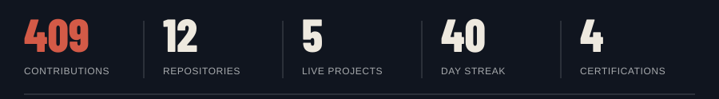
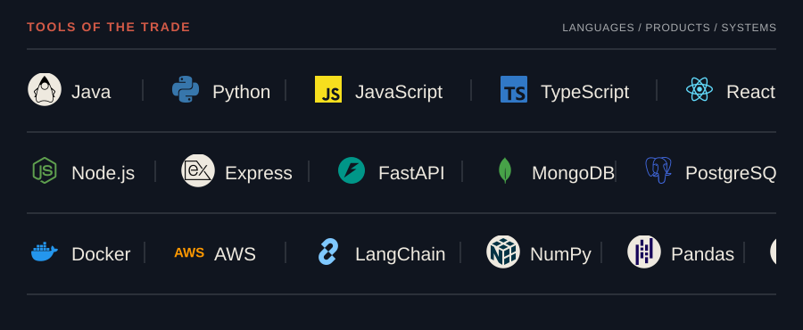
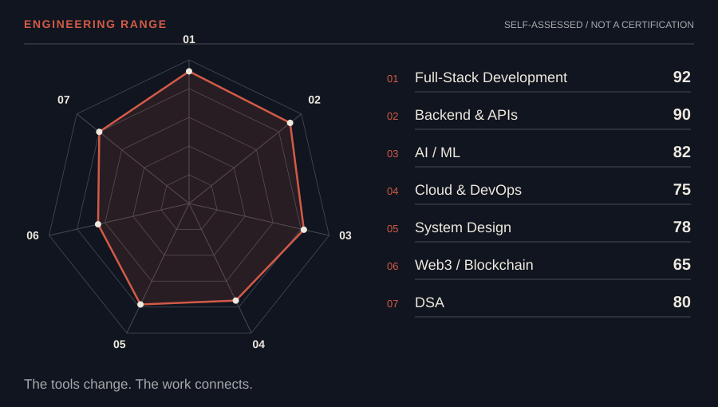
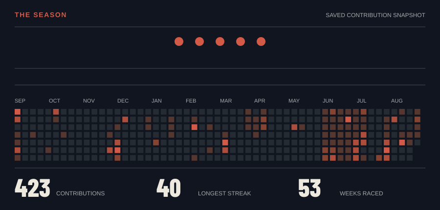
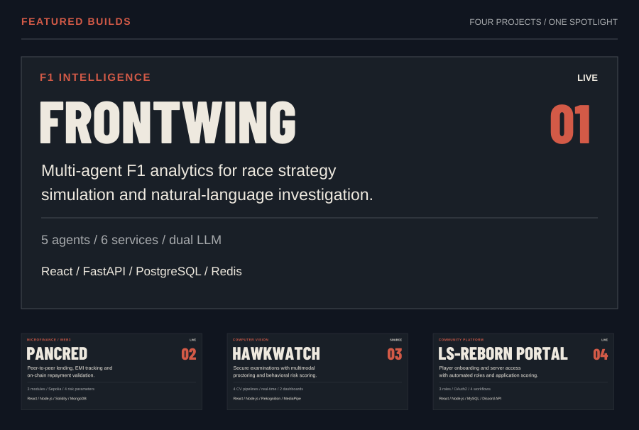
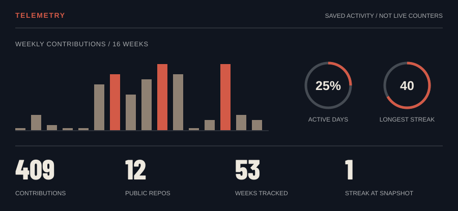
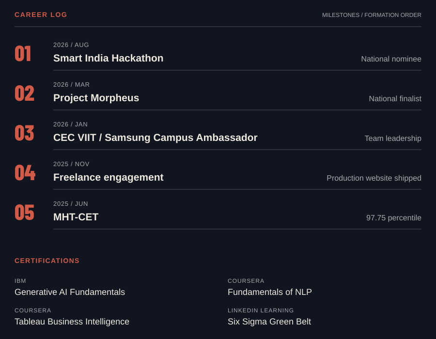

 

  

  

---

## 01 / Who I am

Hi, I'm **Pranav Attarde** — a Computer Science (AI & ML) undergrad at Vishwakarma Institute of
Information Technology, Pune. I build full-stack products and AI-powered backend systems, not just
tutorials — the kind of backend that does something genuinely hard: orchestrating agents, scoring
risk in real time, moving money or trust between systems that don't inherently agree with each other.

- Currently building **[FrontWing](https://frontwing.pranavattarde.in/)**, a multi-agent F1 analytics platform
- Just wrapped an internship building real-time computer-vision proctoring systems at **My WebRide Technologies**
- Smart India Hackathon National Nominee · Finalist, Project Morpheus · led a 75+ member campus team
- Fun fact: **I'll happily spend a weekend on a risk-scoring engine nobody asked for, just to see if it works**

 

## 02 / Toolbox

<picture>
  <source media="(max-width: 600px)" srcset="assets/paddock-toolbox-mobile.svg">
  
</picture>

---

## 03 / Skill radar

<picture>
  <source media="(max-width: 600px)" srcset="assets/paddock-radar-mobile.svg">
  
</picture>

---

## 04 / The season

*Lights out. The race start and contribution track, on loop.*

---

## 05 / Featured builds

*Four builds. One spotlight.*

<picture>
  <source media="(max-width: 600px)" srcset="assets/paddock-projects-mobile.svg">
  
</picture>

[FrontWing](https://frontwing.pranavattarde.in/) · [PanCred](https://www.pancred.space/) · [HawkWatch](https://github.com/pranavattarde/HawkWatch) · [LS-Reborn](https://lsreborn-project.netlify.app/)

Also shipped: **Society Maintenance Management** (AI complaint triage, RBAC, Docker) · **SR Property Advisors** (real-estate CRM/ERP) · **Bias Mitigation of LLMs** (causal-ML research) — all on [GitHub](https://github.com/pranavattarde?tab=repositories).

---

## 06 / Telemetry

<picture>
  <source media="(max-width: 600px)" srcset="assets/paddock-telemetry-mobile.svg">
  
</picture>

Activity graphics retain the existing saved snapshots. They are not live counters. <a href="https://github.com/pranavattarde?tab=overview">View current GitHub activity.</a>

---

## 07 / Career log

<picture>
  <source media="(max-width: 600px)" srcset="assets/paddock-career-mobile.svg">
  
</picture>

---

**[PRANAV ATTARDE](https://www.pranavattarde.in/) / DRIVEN TO BUILD.**

